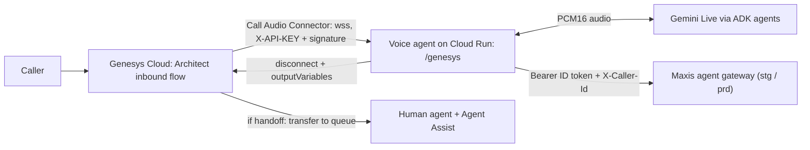

# Genesys Integration (Option A) and Staging Connection

How the Maxis ADK voice agent takes real Genesys Cloud calls, and how to connect
it to the **staging** Genesys flow and the **staging** Maxis agent gateway.

> Status: design. The `/genesys` endpoint isn't built yet. Facts marked
> *(verified)* were checked in `mxs-maxisapp-prd` on 1 Nov 2026. Items marked
> **TBC** need confirmation from Maxis.

---

## 1. Option A in one line

Add a **Genesys Audio Connector WebSocket endpoint (`/genesys`)** to our
existing voice server (`voice_agent/server.py`). Genesys streams the call audio
straight to it, our ADK agents answer through Gemini Live, and the call outcome
(end or handoff) goes back to the Genesys Architect flow.

One service, one network hop, lowest latency. Genesys protocol and auth code are
ported from Google's open-source
[`ces-genesys-adapter`](https://github.com/GoogleCloudPlatform/ces-genesys-adapter)
(Apache-2.0). Maxis already runs that adapter for the CX Studio voicebot
(`ces-genesys-adapter-stg`).



---

## 2. What we reuse and what we build

| Piece | Source | Action |
|---|---|---|
| Genesys protocol (`open`/`opened`, `ping`/`pong`, `close`/`closed`, `update`, `dtmf`, playback events, `disconnect`, audio frames) | `ces-genesys-adapter/src/genesys_ws.py` | Port into `voice_agent/channels/genesys.py` |
| Auth: `X-API-KEY` + HTTP Message Signature (HMAC with client secret) | `ces-genesys-adapter/src/auth.py` | Port as is |
| PII redaction in logs | `ces-genesys-adapter/src/redaction.py` | Port |
| Call logic: ADK session, agents, transcript, outcome | Ours: `streaming_core/call.py` (`Call`, `CallInfo`) | Reuse, no change |
| Gemini Live streaming | Ours: `streaming_core/live_session.py` | Reuse |
| Audio conversion PCMU 8 kHz ↔ PCM16 16/24 kHz | Ours: `streaming_core/audio.py` | Reuse |
| Bot backend | `ces-genesys-adapter/src/ces_ws.py` (CES) | **Not used**: replaced by our `Call` |

### Message mapping

| Genesys Audio Connector | Voice agent |
|---|---|
| `open.parameters.participant.ani` (digits only) | `CallInfo.msisdn`: ADK `user_id` and `X-Caller-Id` on every gateway call |
| `open.parameters.conversationId` | `CallInfo.conversation_id`: ADK `session_id` and `X-Conversation-Id` |
| `open.parameters.inputVariables` | `CallInfo.channel_vars` (for example language, flow name) |
| `open.parameters.media` | Pick PCMU 8 kHz mono; reply `opened` |
| Caller audio (binary, PCMU 8 kHz) | `ulaw_to_pcm16` → `resample_pcm16(8000 → 16000)` → `call.send_audio()` |
| Bot audio | `emit("audio")` PCM16 24 kHz → `resample_pcm16(24000 → 8000)` → `pcm16_to_ulaw` → binary frame |
| Barge-in | `emit("interrupted")` → stop sending queued bot audio |
| `ping` | reply `pong` |
| `close` | reply `closed`, then `await call.finish()` |
| Bot ends call or hands off | send `disconnect` with `outputVariables` (see below), then `call.finish()` |

### Output variables back to Architect (proposal, **TBC** with Maxis Genesys owner)

| Variable | Example | Used by Architect for |
|---|---|---|
| `outcome` | `end` or `handoff` | Branch: disconnect or transfer |
| `handoff_queue` | `roaming_en`, `roaming_bm` | Which queue to transfer to |
| `handoff_reason` | `caller_asked_for_agent` | Reporting |
| `summary` | short PII-safe summary | Shown to the human agent as participant data |
| `language` | `en`, `ms` | Queue / agent skill |

### Security rules for `/genesys`

1. **Reject the WebSocket upgrade** unless `X-API-KEY` matches and the HTTP
   Message Signature is valid (clock skew ≤ 5 min).
2. **Trust the ANI only after auth passes.** It becomes the MSISDN, and the
   gateway trusts `X-Caller-Id` fully.
3. **Store the API key and client secret in Secret Manager** (the client secret is
   base64-encoded), mounted as env vars. Never log them.
4. **Redact the MSISDN and transcripts** in logs (last 4 digits only, as today).

---

## 3. Code layout (planned)

```
voice_agent/
├── server.py                 # + mounts /genesys next to /ws
├── channels/
│   └── genesys/
│       ├── endpoint.py       # WebSocket handler: protocol ↔ Call
│       ├── auth.py           # ported from ces-genesys-adapter
│       └── protocol.py       # message builders (opened, pong, disconnect…)
├── streaming_core/           # unchanged: call.py, live_session.py, audio.py
└── tools/genesys_sim.py      # local simulator: plays a WAV as a Genesys call
```

New settings in `.env`:

| Variable | Purpose |
|---|---|
| `GENESYS_ENABLED` | `true` to mount `/genesys` |
| `GENESYS_API_KEY` | From Secret Manager in Cloud Run |
| `GENESYS_CLIENT_SECRET` | Base64; from Secret Manager in Cloud Run |
| `GENESYS_SIGNATURE_REQUIRED` | `true` in staging/prod; `false` only for the local simulator |

---

## 4. Connecting to staging

Staging has two connections: **Genesys → our agent** (inbound call audio) and
**our agent → Maxis agent gateway** (customer APIs).

### 4.1 What exists in staging today *(verified)*

| Resource | Value |
|---|---|
| GCP project | `mxs-maxisapp-prd` (staging and prod share the project; names end in `-stg`) |
| Existing Genesys adapter (CX Studio bot) | `ces-genesys-adapter-stg`, `us-central1`, `https://ces-genesys-adapter-stg-uk6ub3gyvq-uc.a.run.app` |
| Its Genesys secrets | `genesys-audioconnector-api-key-stg`, `genesys-audioconnector-client-secret-stg` |
| Staging agent gateway | `https://voicebot-cx-studio-agent-gateway-stg-uk6ub3gyvq-as.a.run.app` (`asia-southeast1`, IAM-protected) |
| Prod agent gateway | `https://voicebot-cx-studio-agent-gateway-uk6ub3gyvq-as.a.run.app` |
| Agent Assist listener (not a bot) | `genesys-audio-connector` (AudioHook, listen-only for human agents) |

### 4.2 Genesys staging → our voice agent

1. **Deploy our voice agent to staging on Cloud Run.** Service name proposal:
   `maxis-voice-agent-stg`. Region: `asia-southeast1` (**TBC**). Settings:
   - At least 1 instance always on (no cold start on a call).
   - CPU always allocated, session affinity on.
   - Request timeout 3600 s (one WebSocket lasts the whole call).
   - Runs as service account `maxis-voice-agent@mxs-maxisapp-prd.iam.gserviceaccount.com`.
2. **Create our own Genesys secrets.** Don't reuse the CX Studio ones, so the two
   bots can be rotated and revoked separately:
   ```bash
   gcloud secrets create genesys-voice-agent-api-key-stg --project mxs-maxisapp-prd
   gcloud secrets create genesys-voice-agent-client-secret-stg --project mxs-maxisapp-prd
   # add values (client secret base64-encoded), then:
   gcloud secrets add-iam-policy-binding genesys-voice-agent-api-key-stg \
     --project mxs-maxisapp-prd --role roles/secretmanager.secretAccessor \
     --member serviceAccount:maxis-voice-agent@mxs-maxisapp-prd.iam.gserviceaccount.com
   # repeat for the client secret
   ```
3. **Expose `/genesys` to Genesys.** Genesys needs a public `wss://` URL. Cloud
   Run's IAM check can't be used, because Genesys sends an API key, not a Google
   token. Choose one (**TBC** with Maxis security):
   - **Recommended:** ingress `internal-and-cloud-load-balancing` + external
     HTTPS load balancer + Cloud Armor allowing only Genesys Cloud egress IPs
     for the Maxis region. This matches `genesys-audio-connector`.
   - **Quick staging test:** ingress `all` with `--no-invoker-iam-check`. The
     app's API key + signature check is the only protection. This matches
     `ces-genesys-adapter-stg`.
4. **Genesys admin (Maxis Genesys owner):**
   1. **Admin → Integrations → add "Audio Connector"**, for example
      `Maxis Voice Agent (STG)`.
   2. **Base connection URI:** `wss://<staging host>/genesys`.
   3. **Credentials:** the API key and client secret from step 2.
   4. **Architect:** in a **staging test inbound flow** (separate number, not the
      CX Studio route), add **Call Audio Connector** using this integration.
      Pass `inputVariables` (for example `language`). On return, branch on
      `outcome`: `handoff` → *Transfer to ACD* (`handoff_queue`), otherwise
      disconnect. On failure, transfer to a queue so calls are never dropped.
   5. Publish and assign the flow to a staging DID.
5. **Test:**
   - **Local:** `uv run python tools/genesys_sim.py --url ws://localhost:8080/genesys --wav samples/roaming_q.wav --ani 60XXXXXXXXX`
   - **Staging:** call the staging DID, then check Cloud Run logs for
     `Session … started (genesys, …, msisdn ...XXXX)` and the `disconnect` outcome.

### 4.3 Our voice agent → staging agent gateway

The gateway is a Cloud Run service behind IAM. Every call needs a Google ID token
and the caller's number:

```
Authorization: Bearer <Google-signed ID token, audience = gateway URL>
X-Caller-Id: <MSISDN, digits only>     # from the verified Genesys ANI
X-Conversation-Id: <Genesys conversationId>
```

1. **IAM grant (Maxis admin).** Our runtime SA must be allowed to invoke the
   staging gateway. Today the only invoker is the CES service agent.
   ```bash
   gcloud run services add-iam-policy-binding voicebot-cx-studio-agent-gateway-stg \
     --project mxs-maxisapp-prd --region asia-southeast1 --role roles/run.invoker \
     --member serviceAccount:maxis-voice-agent@mxs-maxisapp-prd.iam.gserviceaccount.com
   ```
2. **Settings in Cloud Run:**
   ```
   GATEWAY_URL=https://voicebot-cx-studio-agent-gateway-stg-uk6ub3gyvq-as.a.run.app
   GATEWAY_AUTH=google_id_token
   GATEWAY_TIMEOUT_S=15
   ```
   `voice_assistant/gateway/auth.py` gets the token from the Cloud Run metadata
   server (`fetch_id_token`), caches it and refreshes it about 5 minutes before
   expiry. No keys are needed.
3. **Local testing** (your own login, or impersonating the SA if you hold
   `roles/iam.serviceAccountTokenCreator`):
   ```bash
   gcloud auth login --update-adc
   export GATEWAY_IMPERSONATE_SA=maxis-voice-agent@mxs-maxisapp-prd.iam.gserviceaccount.com  # optional
   ```
4. **Quick read-only check:**
   ```python
   import subprocess, requests
   BASE = "https://voicebot-cx-studio-agent-gateway-stg-uk6ub3gyvq-as.a.run.app"
   tok = subprocess.run(["gcloud", "auth", "print-identity-token"],
                        capture_output=True, text=True, check=True).stdout.strip()
   r = requests.get(f"{BASE}/account/identify",
                    headers={"Authorization": f"Bearer {tok}", "X-Caller-Id": "60XXXXXXXXX"},
                    timeout=30)
   print(r.status_code, r.json())
   ```
5. **Staging test rules:**
   - Use only **allowlisted staging numbers**. We have one, possibly fibre-only.
     Roaming test numbers (family plan, single line) are **TBC** from Maxis.
   - Staging backends seem to be down overnight; test during MYT business hours.
   - **Never** call `buyPass`/`switchRoaming` with `confirmed=true`,
     `restartFibreRouter` or `sendWhatsAppLink` without Maxis approval. These are
     real lines.

---

## 5. Checklist

| # | Task | Owner |
|---|---|---|
| 1 | Build `/genesys` endpoint, port auth, add simulator | Us |
| 2 | Create SA `maxis-voice-agent` + base roles | Maxis GCP admin |
| 3 | `run.invoker` on `voicebot-cx-studio-agent-gateway-stg` for our SA | Maxis GCP admin |
| 4 | Create Genesys secrets for our bot (stg) | Maxis GCP admin / us |
| 5 | Deploy `maxis-voice-agent-stg` (ingress option per 4.2 step 3) | Us (with approval) |
| 6 | Audio Connector integration + staging Architect flow + DID | Maxis Genesys owner |
| 7 | Agree `outputVariables` and handoff queues | Us + Maxis Genesys owner |
| 8 | Roaming staging test numbers | Maxis |
| 9 | End-to-end staging call incl. handoff to a human | Joint |

## 6. Open questions

- Region for our staging service: `asia-southeast1` (next to the gateway and
  Genesys connector) while Gemini Live runs in `us-central1`?
- Load balancer + Cloud Armor (recommended) or plain ingress for staging?
- Should the bot's transcript also feed Agent Assist (`analyzeContent`) so the
  human sees the bot part of the call after handoff?
- Does the gateway code also check the caller's identity beyond Cloud Run IAM?

## References

- Google adapter: https://github.com/GoogleCloudPlatform/ces-genesys-adapter
- Genesys Gemini Live example (Architect flow, escalation outputs):
  https://github.com/DOAGenesys/Speech_to_Speech_agents-AudioConnector
- Genesys reference server: https://github.com/GenesysCloudBlueprints/audioconnector-server-reference-implementation
- Genesys AudioHook / Audio Connector security: https://developer.genesys.cloud/devapps/audiohook/security
