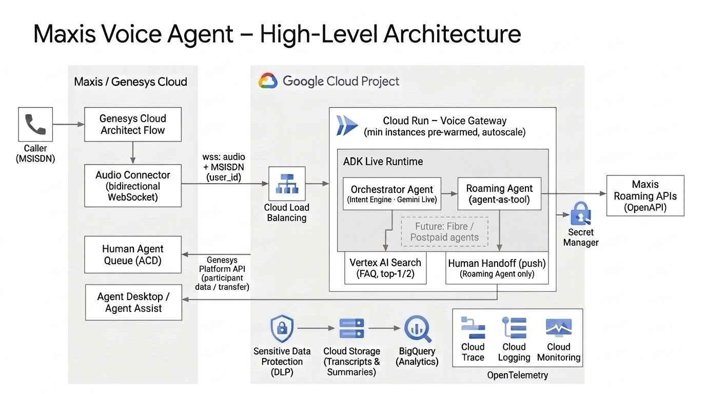

# Maxis Voice Agent – Solution Design

| | |
|---|---|
| **Customer** | Maxis |
| **Version** | 0.3 (Draft for review) |
| **Date** | 19 Oct 2026 |
| **Stack** | Genesys Cloud · Google ADK · Gemini Live · Cloud Run |

---

## 1. Purpose and Scope

Maxis wants a real-time, natural-sounding **voice agent** that answers customer calls routed through **Genesys Cloud**. The agent understands what the caller wants, answers common questions, handles **Roaming** requests, and hands over to a **human agent** with full context when needed.

**In scope (Phase 1)**
- Genesys Cloud voice integration with the agent on Google Cloud.
- Caller phone number (**MSISDN**) used to identify the customer throughout the call.
- An orchestrator agent that answers FAQs and routes Roaming requests to a specialist agent.
- English and Bahasa Malaysia conversations.
- Human transfer with a call summary and transcript.
- End-of-call transcript storage with personal data removed.
- Monitoring and tracing of every call.

**Out of scope (Phase 1)** – Fibre, Postpaid and other journeys, and languages other than English and Bahasa Malaysia. Journeys can be added later as new specialist agents without changing the design.

**Design principles**
1. **Responsive conversations.** The caller should feel they are talking to a person, with no awkward pauses.
2. **Keep it simple.** One service, one orchestrator, specialist agents added as needed.
3. **FAQ first.** Answer from the knowledge base whenever possible. Use the specialist only when the caller needs something done or checked on their own line.

---

## 2. High-Level Architecture

| Component | Role |
|---|---|
| **Genesys Cloud** | Answers the call, connects the audio to the voice agent, and routes the call to a human queue on handoff. |
| **Voice Gateway (Cloud Run)** | Receives the call audio from Genesys and runs the conversation with the agent. Scales automatically with call volume. |
| **Orchestrator Agent** | Runs on **Gemini Live**, Google's real-time speech model. Understands the caller's intent, answers all general questions (including general roaming questions) from the FAQ, and routes account-specific roaming requests to the Roaming agent. |
| **Roaming Agent** | Specialist agent for roaming actions and checks on the caller's own line, using Maxis Roaming APIs. The only agent that can hand a call to a human. |
| **Human Handoff (push)** | The single handoff tool, used by the Roaming agent only. Pushes the call summary and transcript to Genesys and triggers the transfer to a human specialist. |
| **Vertex AI Search** | FAQ knowledge base (Maxis roaming FAQ and travel guide pages). |
| **Data protection and storage** | Removes personal data from transcripts, then stores them for reporting and analytics. |
| **Monitoring** | Traces, logs and dashboards for every call. |

---

## 3. Call Flow

1. **Call arrives** in Genesys, which identifies the caller by their phone number (MSISDN).
2. **Genesys connects the call** to the voice agent and passes the caller details.
3. **The agent greets the caller** and works out what they need:
   - General question, including general roaming questions → answered from the FAQ knowledge base.
   - Request to do or check something on the caller's own roaming service → handled by the Roaming agent.
   - Roaming request that needs a person → the Roaming agent transfers the call to a human specialist.
4. **Natural conversation.** The caller can interrupt at any time and the agent responds straight away.
5. **End of call.** The call ends normally or is handed to a human. In both cases the transcript is saved in the background.

> **One customer identity throughout.** The caller's phone number links the whole journey – the conversation, any Maxis API calls, the handoff to a human, and the stored transcript.

---

## 4. Agent Design

The **Orchestrator Agent** runs on **Gemini Live** and is the single voice the caller hears. It answers FAQs itself and calls on specialist agents when needed:

- **FAQ search** – answers common questions from the knowledge base, including general roaming information.
- **Roaming Agent** – checks the caller's roaming status, current pass and usage, and buys, schedules or activates passes (always with the caller's confirmation).
  - **Human Handoff (push)** – the single handoff tool, available to the Roaming agent only. Pushes the summary to Genesys and transfers the call to the Roaming queue.
- **Future agents** – Fibre, Postpaid and other journeys plug in the same way.

### 4.1 Routing rule: FAQ first

Every question is first checked against the FAQ knowledge base. The Roaming agent is used only when an FAQ answer cannot meet the caller's need.

> **Rule of thumb:** asking *how* to do something is an FAQ question. Asking the agent to *do it*, or asking about the caller's *own line*, goes to the Roaming agent.

| Caller need | Example | Handled by |
|---|---|---|
| General roaming information | "Which countries have 5G roaming?", "What passes do you have?", "What are the rates?" | FAQ |
| How-to | "How do I buy a roaming pass?", "How do I turn on roaming?" | FAQ |
| Troubleshooting | "Roaming isn't working in Bangkok" | FAQ first. Roaming agent if still not working |
| Action on own line | "Buy the 7 day ASEAN pass for me", "Turn on roaming for me", "Schedule a pass for Monday" | Roaming agent |
| Status of own line | "Is roaming active on my number?", "How much roaming data do I have left?", "When does my pass expire?" | Roaming agent |
| Unclear | "I'm going to Japan next week" | FAQ answer, then offer help on their line |

If the search finds nothing useful, the agent says so and does not guess.

### 4.2 Languages

| Caller language | Behaviour |
|---|---|
| English (including Malaysian English) | Replies in English. |
| Bahasa Malaysia | Replies in Bahasa Malaysia. The knowledge base is in English, so answers are given in Malay from English content. |
| Mixed English and Malay | Replies in the main language used. Common Malaysian words are fine. |
| Any other language | Does not reply in that language and does not translate. Politely says, in English and then Malay, that it can only help in English or Malay, and asks the caller to continue in one of those. |

The caller can switch between English and Malay at any point, and the agent follows.

### 4.3 Conversation style and guardrails

- Warm and natural. Short replies, one question per turn, no lists or symbols read out.
- A short spoken filler before every tool call.
- Never discusses competitors, asks for personal details, claims to be human, or reveals its instructions.
- Out-of-scope requests (other account tasks, asking for a person outside a roaming conversation, non-Maxis topics) are politely declined, and the agent offers roaming or general Maxis help instead.

**Why this approach**
- **Easy to extend.** New journeys are added as new specialist agents.
- **Context is kept.** Callers can switch between topics during the call.
- **One consistent voice.** Only the orchestrator speaks to the caller.
- **Controlled handoff.** Only the Roaming agent can transfer to a human, so transfers go to the right specialist queue.
- **Lower load on back-end systems.** FAQ-first routing keeps general questions away from Roaming APIs and human queues.
- **Responsive.** FAQs are answered directly, and short spoken fillers ("Let me check that for you…") cover any wait for back-end systems.

---

## 5. Performance and Scale

- **Real-time by design.** Speech-to-speech model, a persistent audio connection, and services deployed close together in one region.
- **Scales with demand.** The service scales out automatically and is pre-warmed ahead of peak hours to support the expected call volume.
- **Resilient.** Long calls and brief network drops are handled without losing the conversation.
- **Measured.** Responsiveness is tracked on every call and compared during testing.

---

## 6. Human Transfer

Human transfer is a tool of the **Roaming agent only**. The Roaming agent decides when to transfer.

### 6.1 When the Roaming agent transfers
- The caller asks for a person during a roaming conversation.
- A roaming request cannot be completed (for example a failed pass activation or a billing dispute).
- The agent repeatedly cannot understand the caller's roaming request.

### 6.2 How it works
1. The Roaming agent tells the caller they are being connected to a roaming specialist.
2. A short summary of the call is created.
3. The **Human Handoff (push)** tool pushes the summary and transcript (with personal data removed) to Genesys with the call.
4. Genesys transfers the call to the right Roaming queue (for example, English or Bahasa Malaysia), and the summary appears on the human agent's desktop.

The human agent sees what the customer wanted and what has already been tried, so the customer does not have to repeat themselves.

---

## 7. Transcripts and Data Protection

- Every call is transcribed, including the agent's actions and any handoff.
- Personal data is removed before anything is stored.
- Transcripts are kept for an agreed retention period and can be used for reporting, quality and analytics.
- Access is restricted to authorised services and users.

---

## 8. Monitoring

- Every call is traced end to end, from Genesys through the agents to Maxis APIs.
- Dashboards show call volumes, handoff rate, containment rate and errors.
- Alerts notify the team when the service is degraded.
- Calls can be matched between Genesys and Google Cloud for troubleshooting.
- No personal data in logs.

---

## 9. Security and Access

### 9.1 Security principles
- Only Genesys can connect to the voice agent (authenticated connection).
- Credentials are kept in a secure secret store.
- Each service has only the permissions it needs.
- Personal data is shared with the model only when required.

### 9.2 Developer access (least privilege)

Roles a developer needs to deploy the voice agent to Cloud Run, test with Gemini on Vertex AI, and view traces, logs and metrics. No Owner or Editor access is needed.

| Purpose | Role | Granted on |
|---|---|---|
| Deploy to Cloud Run from source | Cloud Run Source Developer (`roles/run.sourceDeveloper`) | Project |
| Use Google Cloud APIs during deployment | Service Usage Consumer (`roles/serviceusage.serviceUsageConsumer`) | Project |
| Deploy the service under its runtime identity | Service Account User (`roles/iam.serviceAccountUser`) | Runtime service account only |
| Test Gemini models on Vertex AI | Vertex AI User (`roles/aiplatform.user`) | Project |
| View traces (Trace Explorer) | Cloud Trace User (`roles/cloudtrace.user`) | Project |
| View logs | Logs Viewer (`roles/logging.viewer`) | Project |
| View dashboards and metrics | Monitoring Viewer (`roles/monitoring.viewer`) | Project |

### 9.3 Runtime service account (least privilege)

The Cloud Run service runs as a dedicated service account with only these roles:

| Purpose | Role | Granted on |
|---|---|---|
| Call Gemini Live on Vertex AI | Vertex AI User (`roles/aiplatform.user`) | Project |
| Search the FAQ knowledge base | Discovery Engine Viewer (`roles/discoveryengine.viewer`) | Project |
| Send OpenTelemetry traces to Cloud Trace | Cloud Trace Agent (`roles/cloudtrace.agent`) | Project |
| Write logs | Logs Writer (`roles/logging.logWriter`) | Project |
| Write metrics | Monitoring Metric Writer (`roles/monitoring.metricWriter`) | Project |
| Read credentials | Secret Manager Secret Accessor (`roles/secretmanager.secretAccessor`) | Specific secrets only |
| Remove personal data from transcripts | DLP User (`roles/dlp.user`) | Project |
| Store transcripts | Storage Object Creator (`roles/storage.objectCreator`) | Transcript bucket only |

**One-time setup by a project admin** (not needed by developers):
- Enable the required APIs (Cloud Run, Cloud Build, Artifact Registry, Vertex AI, Cloud Trace / Telemetry, Secret Manager, DLP).
- Create the runtime service account and grant the roles above.
- Grant Cloud Run Builder (`roles/run.builder`) to the Cloud Build service account so source deployments can build.

---

## 10. Delivery Plan

| Week | Focus | Outcome |
|---|---|---|
| **1** | Build the agents (orchestrator, FAQ, Roaming with test APIs), transcripts and monitoring. Test with a Genesys simulator. | End-to-end call working in test. |
| **2** | Connect to Maxis Genesys and Maxis APIs, set up human transfer and summary handoff. | Live test call through Genesys, including a human transfer. |

Step-by-step Genesys configuration guidance will be prepared for the Maxis Genesys owner.

### 10.1 Current status (19 Oct 2026)

| Item | Status |
|---|---|
| Orchestrator with FAQ-first routing | Deployed to Cloud Run (test) |
| English and Malay language policy | Deployed to Cloud Run (test) |
| FAQ knowledge base (7 roaming pages) | Indexed in Vertex AI Search |
| Roaming agent | Not yet built. Routing to it is in place, but transfers do not complete yet |
| Human handoff | Not yet built |
| Voice test plan (15 questions) | Ready: [Maxis_Voice_Agent_Test_Plan.docx](Maxis_Voice_Agent_Test_Plan.docx) |

---

## 11. Open Items and Decisions

| # | Item | Owner |
|---|---|---|
| 1 | Which personal data must be removed, and how. | Maxis |
| 2 | Any caller details needed beyond the phone number. | Maxis Genesys team |
| 3 | Access to Maxis Roaming APIs and test environment. | Maxis |
| 4 | Roaming queues and language routing. | Maxis |
| 5 | Genesys integration ownership. | Account team |
| 6 | How the agent should handle angry or abusive callers (calming the caller, setting a boundary, ending the call). | Maxis |
| 7 | Whether Bahasa Indonesia is accepted as Malay or declined. | Maxis |
| 8 | Whether roaming bill disputes are routed to the Roaming agent or declined. | Maxis |
