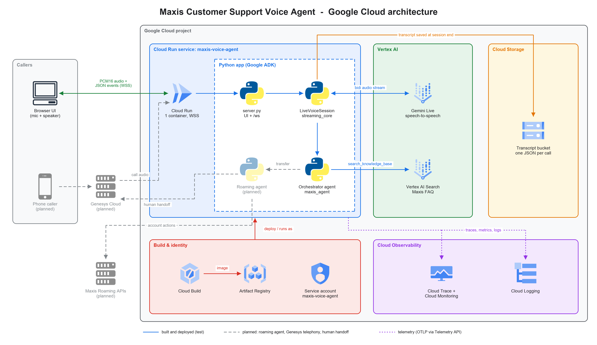

# Maxis Customer Support Voice Agent

A real-time customer support **voice agent** for Maxis, built with
**Google ADK** and **Gemini Live** on **Vertex AI**. A caller speaks; the agent
answers out loud in English or Malay, looks up answers in the Maxis FAQ
(**Vertex AI Search**), and every conversation is saved as a transcript in
**Cloud Storage**. It runs as one container on **Cloud Run**, with traces,
metrics and logs in **Cloud Observability**.

> **Status:** the orchestrator agent with FAQ-first routing and the English/Malay
> language policy is running on Cloud Run (test). The roaming agent, human
> handoff and Genesys telephony are planned (shown dashed in the diagram).

---

## GCP architecture



Solid lines are built and deployed (test); dashed grey lines are planned. The diagram is
generated from [`Documents/diagrams/gcp_architecture.py`](Documents/diagrams/gcp_architecture.py)
using official Google Cloud icons, so edit that file and re-run it when the architecture changes.

| GCP service | What it's used for | Code |
|---|---|---|
| **Cloud Run** | Hosts the UI and the `/ws` voice API in one container. Session affinity, 60 min timeout, CPU always allocated. | [`Dockerfile`](voice_agent/Dockerfile), [`deploy.sh`](voice_agent/deploy.sh) |
| **Vertex AI (Gemini Live)** | Real-time speech-to-speech model (`VOICE_AGENT_MODEL`, voice `VOICE_NAME`). | [`agent.py`](voice_agent/voice_assistant/agent.py), [`live_session.py`](voice_agent/streaming_core/live_session.py) |
| **Vertex AI Search** | Maxis FAQ knowledge base; returns the top 3 snippets. | [`faq_search_tool.py`](voice_agent/voice_assistant/faq_search_tool.py) |
| **Cloud Storage** | One transcript JSON per conversation: `gs://$GCS_BUCKET/$GCS_LOG_PREFIX/conversation_<id>_<ts>.json`. | [`gcs_logger.py`](voice_agent/streaming_core/gcs_logger.py) |
| **Cloud Trace / Monitoring / Logging** | OpenTelemetry: one `voice_session` trace per call, `voice.time_to_first_audio` histogram, `voice.model_turns` counter, ADK logs. | [`server.py`](voice_agent/server.py) (`_setup_otel`), [`live_session.py`](voice_agent/streaming_core/live_session.py) |
| **IAM** | Least-privilege runtime service account `maxis-voice-agent`. | [`deploy.sh`](voice_agent/deploy.sh) |
| **Cloud Build + Artifact Registry** | `gcloud run deploy --source .` builds and stores the image. | [`deploy.sh`](voice_agent/deploy.sh) |

### What happens in one conversation

1. The browser opens a secure WebSocket to `/ws` on Cloud Run; `server.py` checks the `Origin`
   header and replies `ready`.
2. The browser sends `init` with its timezone. The server builds a fresh ADK `Runner` and
   orchestrator agent (today's date goes into the prompt) and starts a `LiveVoiceSession`.
3. `LiveVoiceSession` opens a bidirectional `run_live()` stream to **Gemini Live** on Vertex AI;
   the agent speaks the greeting.
4. Every turn: mic audio (PCM16 16 kHz, base64) goes browser → server → Gemini Live. When the
   caller asks a Maxis question, the agent calls `search_knowledge_base`, which queries
   **Vertex AI Search** and returns the top 3 FAQ snippets.
5. Gemini Live streams back spoken audio (PCM16 24 kHz) plus transcripts; the server forwards
   them to the browser as `audio`, `transcript` and `tool_call` / `tool_result` events. If the
   caller talks over the agent, an `interrupted` event clears queued audio (barge-in).
6. On hang-up or disconnect, `TranscriptLogger` writes the full conversation as one JSON file to
   **Cloud Storage**. Throughout the call, spans and metrics go to **Cloud Trace / Monitoring**
   and logs to **Cloud Logging**.

---

## Repository layout

```text
.
├── README.md                      ← you are here: overview, architecture, layout
├── .gitignore
├── Documents/                     ← design and test documentation
│   ├── Maxis_Voice_Agent_Design.md     solution design (source)
│   ├── Maxis_Voice_Agent_Design.docx   same design, Word version
│   ├── Maxis_Voice_Agent_Test_Plan.docx voice test plan (15 questions)
│   ├── architecture-diagram.jpg        target architecture (incl. Genesys, roaming)
│   ├── gcp-architecture.png            GCP architecture diagram shown above
│   ├── diagrams/                       diagram-as-code: gcp_architecture.py + official GCP icons
│   └── build_docx.py                   Markdown → .docx converter for the design doc
└── voice_agent/                   ← the application (a self-contained uv project)
    ├── server.py                  entry point: WebSocket server + static UI + OpenTelemetry setup
    ├── voice_assistant/           ← WHAT the agent says and does (ADK agent package)
    │   ├── agent.py                   create_root_agent(): the orchestrator agent and its tools
    │   ├── prompts.py                 orchestrator instruction, greeting, language rules
    │   └── faq_search_tool.py         search_knowledge_base tool → Vertex AI Search
    ├── streaming_core/            ← HOW audio is streamed (channel-agnostic, reusable)
    │   ├── live_session.py            LiveVoiceSession: client input → ADK run_live → emit(events); telemetry
    │   ├── gcs_logger.py              TranscriptLogger: collects turns, uploads JSON to GCS
    │   └── utils.py                   sample rates, logger, timezone/date helper
    ├── static/                    ← browser test client
    │   ├── index.html, styles.css, app.js   UI, transcript and activity panels
    │   └── pcm-recorder.js, pcm-player.js   AudioWorklets: mic → PCM16 16k, PCM16 24k → speaker
    ├── scripts/
    │   └── bench_faq_search.py        latency benchmark for the FAQ search tool
    ├── pyproject.toml, uv.lock    Python dependencies (managed with uv)
    ├── .env.example               every setting, documented; copy to .env
    ├── Dockerfile                 Cloud Run image (non-root, no .env baked in)
    ├── deploy.sh                  one-command Cloud Run deploy (APIs, service account, IAM, env)
    ├── .dockerignore, .gcloudignore  keep .env, .venv, caches out of the build
    └── README.md                  run, deploy and operate the service
```

### Where to make a change

| I want to… | Edit |
|---|---|
| Change what the agent says, its rules, greeting or languages | [`voice_assistant/prompts.py`](voice_agent/voice_assistant/prompts.py) |
| Add a tool or a sub-agent (e.g. the roaming agent) | new file in `voice_assistant/`, then register it in [`agent.py`](voice_agent/voice_assistant/agent.py) (`tools=[...]` / `sub_agents=[...]`) |
| Change FAQ search behaviour (result count, engine) | [`faq_search_tool.py`](voice_agent/voice_assistant/faq_search_tool.py), `FAQ_SEARCH_ENGINE_ID` in `.env` |
| Change the model, voice, or audio/transcription config | `VOICE_AGENT_MODEL` / `VOICE_NAME` in `.env`, `default_run_config()` in [`live_session.py`](voice_agent/streaming_core/live_session.py) |
| Add a new channel (e.g. Genesys telephony) | new endpoint next to [`server.py`](voice_agent/server.py) that reuses `LiveVoiceSession` with its own `emit` and audio conversion |
| Change what's saved in transcripts | [`gcs_logger.py`](voice_agent/streaming_core/gcs_logger.py) |
| Change the WebSocket protocol or security checks | [`server.py`](voice_agent/server.py) (protocol documented in its docstring) |
| Change the browser UI | [`static/`](voice_agent/static) |
| Change Cloud Run sizing, IAM or env vars | [`deploy.sh`](voice_agent/deploy.sh), [`.env.example`](voice_agent/.env.example) |

---

## Quick start (local)

Prerequisites: Python 3.12+, [uv](https://docs.astral.sh/uv/), the `gcloud` CLI, and a
GCP project with Vertex AI and Vertex AI Search enabled.

```bash
gcloud auth application-default login
cd voice_agent
cp .env.example .env        # set GOOGLE_CLOUD_PROJECT, FAQ_SEARCH_ENGINE_ID, GCS_BUCKET
uv sync
uv run python server.py     # open http://127.0.0.1:8080 and click "Start talking"
```

Try: *"What roaming passes do you have?"* or *"Macam mana nak aktifkan roaming?"*

Leave `GCS_BUCKET` empty to save transcripts to `voice_agent/transcripts/` instead.

## Deploy to Cloud Run

```bash
gcloud auth login && gcloud auth application-default login
cd voice_agent && ./deploy.sh   # prints the UI URL plus Trace, Metrics and Logs links
```

See [`voice_agent/README.md`](voice_agent/README.md) for configuration, IAM roles,
observability details and production notes.

## Security notes

- `.env` is git-ignored and never baked into the image; settings reach Cloud Run as env vars.
- `/ws` only accepts the configured `ALLOWED_ORIGINS`; there is **no user auth yet**.
  `deploy.sh` uses `--allow-unauthenticated` for the demo, so put IAP or auth in front
  before real traffic.
- Transcripts contain caller speech (PII): keep the bucket private, add retention and
  consider CMEK. Caller speech is kept out of traces unless
  `ADK_CAPTURE_MESSAGE_CONTENT_IN_SPANS=true`.
