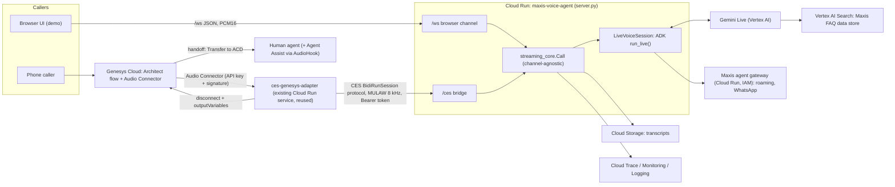

# Maxis Customer Support Voice Agent

A real-time customer support **voice agent** for Maxis, built with **Google ADK** and
**Gemini Live** on **Vertex AI**. A caller speaks; the agent answers out loud in English or
Malay, answers Maxis questions from the FAQ (**Vertex AI Search**), helps with roaming on the
caller's own line through the **Maxis agent gateway**, and hands over to a human when needed.
The same agent serves two channels:

- **Browser** (demo / testing): mic in the web UI → WebSocket `/ws`.
- **Genesys Cloud telephony**: phone call → Genesys Audio Connector → the **existing
  `ces-genesys-adapter`** on Cloud Run → our `/ces` bridge.

Everything runs as one container on **Cloud Run**, with transcripts in **Cloud Storage** and
traces, metrics and logs in **Cloud Observability**.

> **Status (4 Nov 2026)**
>
> | Area | State |
> |---|---|
> | Orchestrator `maxis_agent` (FAQ-first, English/Malay only) | Working (local + Cloud Run test) |
> | Roaming specialist `roaming_agent` + gateway tools (real staging gateway, no mocks) | Working locally. Read tools live; **write tools (buy / switch / WhatsApp) disabled** until Maxis approves |
> | Human handoff (`escalateToAgent` → call outcome) | Working: shown in the browser; becomes Genesys outputVariables on telephony |
> | Genesys telephony via the existing adapter (`/ces` bridge) | **Built + offline-tested, not deployed.** Waiting on permission to deploy the adapter change (see [Genesys telephony](#genesys-telephony-reusing-the-existing-adapter)) |
> | Production deploy in Maxis project | Not done: needs service account, IAM grants and approval |

---

## Contents

1. [Architecture](#architecture)
2. [What happens in one call](#what-happens-in-one-call)
3. [Agents and tools](#agents-and-tools)
4. [Genesys telephony: reusing the existing adapter](#genesys-telephony-reusing-the-existing-adapter)
5. [Repository layout](#repository-layout)
6. [Where to make a change](#where-to-make-a-change)
7. [Quick start (local)](#quick-start-local)
8. [Testing](#testing)
9. [Deploy to Cloud Run](#deploy-to-cloud-run)
10. [Security](#security)
11. [Open items](#open-items)

---

## Architecture



The static GCP diagram (official icons) is
[`Documents/gcp-architecture.png`](Documents/gcp-architecture.png), generated from
[`Documents/diagrams/gcp_architecture.py`](Documents/diagrams/gcp_architecture.py). Re-run that
script when the architecture changes.

| GCP service | What it's used for | Code |
|---|---|---|
| **Cloud Run** | Hosts the UI, `/ws` (browser) and `/ces/<location>` (telephony bridge) in one container. Session affinity, 60 min timeout, CPU always allocated. | [`Dockerfile`](voice_agent/Dockerfile), [`deploy.sh`](voice_agent/deploy.sh) |
| **Vertex AI (Gemini Live)** | Real-time speech-to-speech model (`VOICE_AGENT_MODEL`, default `gemini-3.8-live`; voice `VOICE_NAME`). | [`agent.py`](voice_agent/voice_assistant/agent.py), [`live_session.py`](voice_agent/streaming_core/live_session.py) |
| **Vertex AI Search** | Maxis FAQ data store (`FAQ_DATASTORE_ID`) via ADK's built-in `VertexAiSearchTool`, grounded natively inside the Live turn. | [`agent.py`](voice_agent/voice_assistant/agent.py) |
| **Maxis agent gateway** (Cloud Run, IAM-protected) | Customer APIs (roaming lines, passes, purchases, WhatsApp). Called with a Google ID token + `X-Caller-Id` (MSISDN) + `X-Conversation-Id`. | [`gateway/`](voice_agent/voice_assistant/gateway) |
| **ces-genesys-adapter** (existing Cloud Run service) | Terminates Genesys Audio Connector; reused unchanged except its backend URL. | [`channels/ces_bridge.py`](voice_agent/channels/ces_bridge.py) |
| **Secret Manager** | Shared bridge token (same secret as the adapter's `AUTH_TOKEN_SECRET_PATH`). | [`deploy.sh`](voice_agent/deploy.sh) |
| **Cloud Storage** | One transcript JSON per conversation: `gs://$GCS_BUCKET/$GCS_LOG_PREFIX/conversation_<id>_<ts>.json`. | [`gcs_logger.py`](voice_agent/streaming_core/gcs_logger.py) |
| **Cloud Trace / Monitoring / Logging** | OpenTelemetry: one `voice_session` trace per call, `voice.time_to_first_audio`, `voice.model_turns`, ADK logs. | [`server.py`](voice_agent/server.py), [`live_session.py`](voice_agent/streaming_core/live_session.py) |
| **IAM** | Least-privilege runtime service account `maxis-voice-agent`. | [`deploy.sh`](voice_agent/deploy.sh) |

### Design principle: channels are thin, the call is shared

[`streaming_core/call.py`](voice_agent/streaming_core/call.py) (`Call` + `CallInfo`) owns
everything about a conversation: ADK session, agent tree, Gemini Live stream, transcript,
keyboard-click "bridge" sound during tool calls, and the call outcome (end / handoff). A
channel only has to:

1. build a `CallInfo` (`msisdn`, `conversation_id`, `channel`, `channel_vars`),
2. feed caller audio with `call.send_audio()` (PCM16 16 kHz) / text with `call.send_text()`,
3. pass an `emit(kind, **data)` callback that delivers bot audio (PCM16 24 kHz) and events,
4. act on `call.ended` / `call.outcome` (hang up, or hand off).

The browser channel (`_handle_client` in [`server.py`](voice_agent/server.py)) and the telephony
bridge ([`channels/ces_bridge.py`](voice_agent/channels/ces_bridge.py)) are both ~150 lines.

---

## What happens in one call

### Phone (Genesys)

1. The caller dials the Maxis number. The Genesys **Architect** inbound flow runs **Call Audio
   Connector**, passing input variables (for example `msisdn = Call.Ani`, `language`).
2. Genesys opens a WebSocket to the **ces-genesys-adapter**, which checks the Genesys API key and
   HTTP message signature, answers `opened` and opens its backend connection to
   `wss://<voice agent>/ces/<location>` with `Authorization: Bearer <shared token>`.
3. `server.py` checks the token **before** the WebSocket opens (401 otherwise). The bridge reads
   the adapter's `config` (session id = Genesys `conversationId`), `variables` and
   `session_start`, builds a `CallInfo` and starts a `Call`. `session_start` sends the
   kickstart text (`Hello`) so the agent greets straight away.
4. Caller audio (MULAW 8 kHz) → PCM16 16 kHz → Gemini Live. Bot audio (PCM16 24 kHz) → MULAW
   8 kHz → adapter, which paces it to Genesys. When the caller talks over the bot, the bridge
   sends `interruptionSignal` and the adapter drops the buffered audio (barge-in).
5. Questions about prices, coverage or how-to are answered from the FAQ. Requests about the
   caller's own line ("which pass do I have?") transfer to `roaming_agent`, whose tools call the
   gateway with `X-Caller-Id = <MSISDN from the call>`. Keyboard clicks cover the waiting time.
6. If the caller needs a person, `escalateToAgent` records a handoff outcome. After the "connecting
   you" line, the bridge sends `endSession` with the outcome as params. The adapter plays out the
   remaining audio and sends Genesys `disconnect` with those params as **outputVariables**.
   Architect then transfers to the right queue.
7. The transcript is saved to Cloud Storage; the trace shows the whole call.

### Browser (demo)

1. The UI opens `/ws` (Origin checked), sends `init` with its timezone and the demo caller number.
2. Same `Call` as above; audio is base64 PCM16 in JSON messages. Handoff / end outcomes appear
   in the activity panel.

---

## Agents and tools

```
maxis_agent (orchestrator, Gemini Live)
├── tool: VertexAiSearchTool (Maxis FAQ data store) - "FAQ first, always"
└── sub-agent: roaming_agent (transfer_to_agent)
    ├── listRoamingLines   GET  /roaming/lines
    ├── findPasses         GET  /roaming/passes
    ├── listMyPasses       GET  /roaming/purchases
    ├── buyPass            POST /roaming/purchases     (disabled: post_disabled())
    ├── helpWithWrongPass  POST /roaming/wrong-pass    (disabled)
    ├── switchRoaming      POST /roaming/switch        (disabled)
    ├── sendWhatsAppLink   POST /messages/whatsapp     (disabled)
    └── escalateToAgent    local: sets call_outcome = handoff
```

- **Prompts**: [`prompts.py`](voice_agent/voice_assistant/prompts.py) (orchestrator),
  [`flows/roaming/prompt.py`](voice_agent/voice_assistant/flows/roaming/prompt.py),
  shared rules in [`shared/prompt.py`](voice_agent/voice_assistant/shared/prompt.py): English and
  Malay only (anything else gets a fixed bilingual refusal), say a short line before every tool
  call, the specialist-transfer line.
- **Identity never comes from the model**: the MSISDN and conversation id live in ADK session
  state (set by the channel). The gateway client reads them from there; they are never tool
  parameters.
- **Errors**: every tool is wrapped in `@safe_tool` (one try/except). Timeouts, 4xx/5xx and
  backend errors become a polite "I'm facing an internal error" envelope; business answers (for
  example `NOT_A_MAXIS_NUMBER`) pass through so the model follows `next_step`.
- **Write actions are disabled** (`post_disabled()`) until Maxis approves testing on real lines.
- `endCall` exists in [`shared/tools.py`](voice_agent/voice_assistant/shared/tools.py) but is not
  given to any agent yet.
- **Adding a flow** (for example fibre): copy `flows/roaming/` to `flows/fibre/` and add it to
  `FLOWS` in [`flows/__init__.py`](voice_agent/voice_assistant/flows/__init__.py).

---

## Genesys telephony: reusing the existing adapter

Maxis already runs Google's open-source
[`ces-genesys-adapter`](https://github.com/GoogleCloudPlatform/ces-genesys-adapter) on Cloud Run
(`ces-genesys-adapter-stg`) for the CX Agent Studio bot. It does all the Genesys work: API key +
HTTP message signature, `open`/`opened`, ping, DTMF, audio pacing, barge-in buffer clearing, and
`disconnect` with outputVariables. Only its backend client (`ces_ws.py`) is CES-specific.

So instead of writing our own Genesys endpoint, **our server speaks the CES BidiRunSession
protocol** on `/ces/<location>` ([`channels/ces_bridge.py`](voice_agent/channels/ces_bridge.py)).
The adapter needs a single change: make its CES URL configurable.

> **Why not the AudioHook integration** (`agent-assist-integrations/genesyscloud-audiohook`, the
> `genesys-audio-connector` service)? AudioHook is **listen-only** (no audio back to the caller,
> no output variables). It is for Agent Assist on human calls and stays useful after a handoff.

### Protocol mapping

| Adapter → us | Our bridge |
|---|---|
| `{"config": {"session": "<app>/sessions/<conversationId>"}}` | `CallInfo.conversation_id` = ADK `session_id` and `X-Conversation-Id` |
| `{"realtimeInput": {"variables": {...}}}` (Architect input variables) | Validated → `CallInfo.channel_vars` → session state `channel_vars` |
| variable `msisdn` (or `ani`, `caller_id`), e.g. `tel:+60123456789` | Digits only → `CallInfo.msisdn` = ADK `user_id` and `X-Caller-Id`. Missing → `anonymous` (FAQ works, account tools refuse) |
| `{"realtimeInput": {"event": {"event": "session_start"}}}` or `text` | Start the call; send kickstart text so the agent greets |
| `{"realtimeInput": {"audio": "<b64 MULAW 8k>"}}` | `ulaw_to_pcm16` → resample 8k→16k → `call.send_audio()` |
| `{"realtimeInput": {"dtmf": "5"}}` | `call.send_text("[The caller pressed 5 on the keypad]")` |
| `sys.remote-call-disconnected` event / `clientHalfClose` | Caller hung up → `endSession` (no params) → close |

| Us → adapter | Meaning |
|---|---|
| `{"sessionOutput": {"audio": "<b64 MULAW 8k>"}}` | Bot speech (adapter paces it to Genesys) |
| `{"interruptionSignal": {}}` | Barge-in: adapter clears queued audio |
| `{"endSession": {"metadata": {"params": {...}}}}` + close 1000 | Call over: adapter plays out queued audio, then Genesys `disconnect` (completed) with params as **outputVariables** |
| close 1011 | Internal error: adapter sends `disconnect` (error) → Architect failure path (route to a queue) |

### Output variables for Architect (flat strings)

| Variable | When | Example |
|---|---|---|
| `outcome` | always (if the agent decided) | `handoff` or `end` |
| `handoff_reason` | handoff | `caller asked for a person` |
| `summary` | handoff | what the caller wanted (for the human agent's screen) |
| `use_case` | handoff, roaming | `buy_a_pass`, `pass_bought_by_mistake`, `roaming_on_off` |
| `destination`, `pass_name` | handoff, when known | `Japan`, `Asia 7-day pass` |
| `end_reason` | end | `resolved`, `caller_done`, `no_response`, `unsupported_language` |

### Rollout steps (waiting on permission)

1. **Adapter, one line** in `src/ces_ws.py`:
   `_BASE_WS_URL = os.getenv("CES_WS_URL", "wss://ces.googleapis.com/ws/google.cloud.ces.v1.SessionService/BidiRunSession/locations/")`.
   Deploy as a **second Cloud Run service from the same image** (repointing the shared
   `ces-genesys-adapter-stg` would break the CX Studio bot) with
   `CES_WS_URL=wss://<voice agent host>/ces/` and `AUTH_TOKEN_SECRET_PATH=<token secret>`.
2. **Token secret** in Secret Manager: JSON `{"access_token": "<random, ≥ 32 chars>", "expiry": <far-future epoch ms>}`;
   grant `secretAccessor` to both service accounts.
3. **Deploy the voice agent** with `CES_BRIDGE_ENABLED=true`, `BROWSER_CHANNEL_ENABLED=false`,
   `CES_BRIDGE_TOKEN_SECRET=<secret name>`.
4. **Genesys Architect** (staging flow + DID first): Call Audio Connector using the new adapter's
   integration, input variables `_agent_id = projects/<project>/locations/us/apps/adk` (the adapter
   requires it; only `us` is used, as the URL suffix), `msisdn = Call.Ani`, plus any others. On
   return branch on `outcome` (`handoff` → Transfer to ACD by `use_case` / language); failure path
   → queue, so calls are never dropped.
5. **End-to-end staging call**, then production hardening (see [Security](#security)).

More detail: [`Documents/Genesys_Integration_README.md`](Documents/Genesys_Integration_README.md)
(earlier design notes, staging resources, gateway access).

---

## Repository layout

```text
.
├── README.md                      ← you are here
├── .gitignore                     ← .env and .env.* (except .env.example) are never committed
├── Documents/                     ← design, test and integration docs
│   ├── Maxis_Voice_Agent_Design.md / .docx   solution design
│   ├── Maxis_Voice_Agent_Test_Plan.docx      voice test plan
│   ├── Genesys_Integration_README.md         Genesys + staging connection notes
│   ├── Genesys_Integration_Summary.md / .docx
│   ├── architecture-diagram.jpg              target architecture
│   ├── gcp-architecture.png                  GCP diagram (generated)
│   ├── diagrams/                             diagram-as-code + official GCP icons
│   └── build_docx.py                         Markdown → .docx converter
└── voice_agent/                   ← the application (self-contained uv project)
    ├── server.py                  entry point: HTTP UI + /ws + /ces, auth checks, OpenTelemetry
    ├── channels/
    │   └── ces_bridge.py          Genesys telephony: CES protocol ↔ Call (for ces-genesys-adapter)
    ├── streaming_core/            ← HOW a call is streamed (channel-agnostic)
    │   ├── call.py                    Call + CallInfo: session, agents, outcome, transcript
    │   ├── live_session.py            LiveVoiceSession: ADK run_live ↔ emit(events), telemetry
    │   ├── audio.py                   MULAW ↔ PCM16, resampling (pure Python)
    │   ├── bridge_sound.py            keyboard clicks while tools / transfers run
    │   ├── gcs_logger.py              TranscriptLogger → Cloud Storage (or ./transcripts)
    │   └── utils.py                   sample rates, logger, timezone/date helper
    ├── voice_assistant/           ← WHAT the agent says and does (ADK agent package)
    │   ├── agent.py                   create_root_agent(): maxis_agent + FAQ + flows
    │   ├── prompts.py                 orchestrator instruction + greeting
    │   ├── flows/roaming/             roaming_agent: agent.py, prompt.py, tools.py
    │   ├── shared/                    rules shared by all agents; WhatsApp, escalate, endCall
    │   └── gateway/                   Maxis gateway client, ID-token auth, envelopes, @safe_tool
    ├── static/                    browser test client (UI + AudioWorklets)
    ├── scripts/
    │   ├── test_ces_bridge.py         offline test of /ces (stub call, no network)
    │   └── ces_adapter_sim.py         adapter stand-in: real Gemini call from WAV files
    ├── archive/                   retired code (old FAQ search tool, mocks) for reference
    ├── pyproject.toml, uv.lock    dependencies (uv)
    ├── .env.example               every setting, documented; copy to .env
    ├── Dockerfile                 Cloud Run image (non-root, no .env baked in)
    ├── deploy.sh                  one-command Cloud Run deploy
    └── README.md                  run, configure, test, deploy, operate
```

## Where to make a change

| I want to… | Edit |
|---|---|
| Change what the agent says, its rules, greeting or languages | [`prompts.py`](voice_agent/voice_assistant/prompts.py), [`shared/prompt.py`](voice_agent/voice_assistant/shared/prompt.py), flow `prompt.py` |
| Add a specialist flow (fibre, billing…) | copy [`flows/roaming/`](voice_agent/voice_assistant/flows/roaming), add to `FLOWS` in [`flows/__init__.py`](voice_agent/voice_assistant/flows/__init__.py) |
| Add / change a gateway tool | flow `tools.py` using `call_gateway` ([`gateway/client.py`](voice_agent/voice_assistant/gateway/client.py)) |
| Change handoff / end behaviour or Genesys outputVariables | [`shared/tools.py`](voice_agent/voice_assistant/shared/tools.py) (outcome), `output_variables()` in [`ces_bridge.py`](voice_agent/channels/ces_bridge.py) |
| Change how Genesys variables / caller number are read | `MSISDN_VARIABLES`, `_clean_variables()` in [`ces_bridge.py`](voice_agent/channels/ces_bridge.py) |
| Change the FAQ data store | `FAQ_DATASTORE_ID` in `.env` |
| Change model, voice, transcription languages | `.env` (`VOICE_AGENT_MODEL`, `VOICE_NAME`, `TRANSCRIPTION_LANGUAGE_CODES`), [`live_session.py`](voice_agent/streaming_core/live_session.py) |
| Add another channel | new module in [`channels/`](voice_agent/channels) that builds `CallInfo` and drives `Call`; route it in `server.py` |
| Change transcripts | [`gcs_logger.py`](voice_agent/streaming_core/gcs_logger.py) |
| Change Cloud Run sizing, IAM, env vars, secrets | [`deploy.sh`](voice_agent/deploy.sh), [`.env.example`](voice_agent/.env.example) |

---

## Quick start (local)

Prerequisites: Python 3.12+, [uv](https://docs.astral.sh/uv/), the `gcloud` CLI, access to a GCP
project with Vertex AI and the FAQ data store, and (for roaming tools) `run.invoker` on the
gateway.

```bash
gcloud auth login --update-adc     # ADC for Vertex AI; also used for the gateway ID token
cd voice_agent
cp .env.example .env               # set GOOGLE_CLOUD_PROJECT, FAQ_DATASTORE_ID, GATEWAY_URL, DEMO_MSISDNS
uv sync
uv run python server.py            # http://127.0.0.1:8080 → "Start talking"
```

Try *"What roaming passes do you have for Japan?"*, *"Which roaming pass do I have?"* (transfers to
the roaming specialist), *"Macam mana nak aktifkan roaming?"*, *"Can I speak to a person?"*.

## Testing

| Test | Command (from `voice_agent/`) | Needs |
|---|---|---|
| Telephony bridge, offline (auth, audio, DTMF, barge-in, outcome → outputVariables, hang-up) | `uv run python scripts/test_ces_bridge.py` | nothing (loopback only) |
| Real Gemini call through `/ces` (adapter stand-in, WAV caller turns) | see [`voice_agent/README.md`](voice_agent/README.md#test-the-telephony-bridge) | ADC, network |
| Browser end-to-end | `uv run python server.py` and talk | ADC, network |

## Deploy to Cloud Run

```bash
cd voice_agent && ./deploy.sh      # reads .env; prints the UI URL and Trace / Metrics / Logs links
```

Two typical deployments from the same code:

| Service | `BROWSER_CHANNEL_ENABLED` | `CES_BRIDGE_ENABLED` | Use |
|---|---|---|---|
| demo / test | `true` | `false` | browser UI for demos and prompt testing |
| telephony (prod) | `false` | `true` (+ `CES_BRIDGE_TOKEN_SECRET`) | only the authenticated `/ces` bridge is reachable |

Details (IAM roles, settings, observability, troubleshooting) are in
[`voice_agent/README.md`](voice_agent/README.md).

## Security

- `.env` and `.env.*` backups are git-ignored and never baked into the image; settings reach
  Cloud Run as env vars, the bridge token via **Secret Manager**.
- **Telephony**: Genesys is authenticated by the adapter (API key + HTTP message signature). The
  adapter is authenticated by us with a Bearer token (constant-time compare, checked before the
  WebSocket opens, fails closed if the token is missing or shorter than 32 characters). The caller
  number is only trusted because both hops are authenticated.
- **All channel input is untrusted**: variables are allow-listed and length-capped, audio frames
  size-capped and strictly base64-decoded, DTMF limited to `0-9*#`.
- **Logs**: only the last 4 digits of the MSISDN and variable *names* are logged; errors to the
  peer are generic.
- **Browser channel**: Origin check only, no user auth; the UI's caller number is limited to
  `DEMO_MSISDNS` unless `ALLOW_ANY_MSISDN=true` (testing only). Disable it in production
  (`BROWSER_CHANNEL_ENABLED=false`).
- `TODO(security)`: `deploy.sh` uses `--allow-unauthenticated` (the adapter sends its own token,
  not a Google ID token). For production also restrict ingress: internal ingress + Direct VPC
  egress from the adapter, or an HTTPS load balancer with Cloud Armor.
- Transcripts contain caller speech (PII): private bucket, retention policy, consider CMEK.
  Caller speech stays out of traces unless `ADK_CAPTURE_MESSAGE_CONTENT_IN_SPANS=true`.

## Open items

- Permission to deploy the adapter change + token secret, then the staging end-to-end call.
- Maxis: service account `maxis-voice-agent`, `run.invoker` on the gateway, production approval.
- Staging roaming test numbers (family plan + single line); then enable write tools with approval.
- Check `gemini-3.8-live` in `asia-southeast1` (faster connect and agent transfers, ~5 s today).
- Persistent `SessionService` (today `InMemorySessionService`, fine for one-instance calls).
- FAQ data check: 1-day pass price quoted as RM38 and once RM29.
